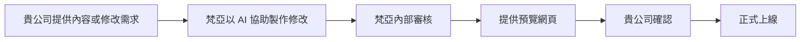

# AQUASKY 官網改版規劃摘要（客戶版）

文件日期：2026-09-24
提案單位：梵亞行銷有限公司
對象網站：<https://aquaskyplus.com/>
文件狀態：搭配報價單 `VY-2026-0924`（V4）說明；範圍、金額與條款以報價單為準。

## 1. 為什麼要改版

目前官網由原工程師維護，後台結構複雜，部分內容更新須先請工程師調整架構才能上稿，行銷修改的協調成本高。

本次改版的目的：

1. **更新快速且可控**：貴公司提供內容後由梵亞以 AI 協助修改，每次更新都先產生預覽，確認後才上線。
2. **不再依賴單一維護者**：網站使用開源技術與標準流程；如終止合作，梵亞提供網站程式與內容完整交付。
3. **改善版型與手機瀏覽體驗**，同時保留品牌辨識。
4. **統一產品資訊**：各語系的規格、型號使用同一份已確認資料，避免數字不一致。
5. **兼顧搜尋與 AI 搜尋**：保留既有搜尋排名基礎，並讓 Google 與 AI 搜尋服務更容易正確理解 AQUASKY。

需要說明：更換網站技術本身**不保證**排名、AI 引用或詢問量一定提升；成效來自正確、完整、容易讀取的內容，會在上線後持續觀察。

## 2. 會改什麼、不會改什麼

| 項目 | 保留 | 改善 |
| --- | --- | --- |
| 網域與網址 | 保留現有網域與重要網址 | 必要的網址差異逐筆設定導向，不全部導回首頁 |
| 品牌與主要內容 | 保留已確認的產品、文章、影片與下載 | 既有內容原樣搬移，整理成結構化資料 |
| 版面設計 | 保留品牌識別 | 版型、導覽、手機版全面更新 |
| 多語系 | 保留現有六種語系 | 語系切換、對應關係更清楚；阿拉伯文右至左版面實測 |
| LQCOL-PLUS 產品頁 | 保留現有內容 | 新增「問與答」「檔案下載」「相關連結」單元（英文版） |
| 產品說明書專區 | — | 新增四個系列說明書頁，手機直接閱讀；固定網址供產品標籤 QR Code 使用 |
| 聯絡表單 | 保留詢問功能 | 重建送出與防濫用機制；通知寄至貴公司指定信箱，並附自動回覆給詢問者 |
| 選型工具 | 保留三類工具 | 依計算公式重建，並以已知案例驗證結果 |
| 後台 CMS | 不再使用 | 改為「提供內容 → 預覽 → 確認 → 發布」 |

不含：內容改寫、重新翻譯或新增語系內容；新拍攝影片、圖片或新品牌識別；報價單未列出的新功能（如會員、線上詢價系統、AI 客服）。

## 3. 以後網站怎麼更新

- 內容修改與說明書更換上架**不限次數**，包含在 AI 網站維護服務內。
- 貴公司看到的是實際網頁預覽，包括手機畫面，不需要讀程式。
- 預覽網址不公開、不會被搜尋引擎收錄。
- 若提出修改，會產生新版本並重新確認，舊的確認不沿用。
- 每次發布保留版本紀錄，必要時可還原上一版。
- 說明書**換檔不換網址**，已印刷的 QR Code 持續有效；各系列網址於 QR Code 印刷前定案，印後不再變更。
- 產品規格、保固、MOQ、交期、認證等資訊，一律以貴公司提供並確認的資料為準，AI 不會自行補數字。

## 4. 網站資產與交接

| 資產 | 說明 |
| --- | --- |
| 網域 | 維持貴公司名下；網域註冊與續費由貴公司自理；DNS 經貴公司授權由梵亞於 Cloudflare 代為設定 |
| 網站程式與主機 | 由梵亞建置，並以年度主機代管服務維運 |
| 內容、產品資料、圖片與說明書檔案 | 屬貴公司所有 |

如雙方終止合作，梵亞將提供網站程式與內容檔案完整交付，供貴公司或其他廠商接續維護。網站使用開源技術與標準流程，沒有專屬後台綁定。

## 5. 時程

工期自貴公司提供所需資料起約 **1～2 個月**。每次預覽請於 5 個工作天內回覆，逾期工期順延。

| 階段 | 內容 | 預估 |
| --- | --- | --- |
| 1. 盤點與確認 | 網址、語系、頁面類型、附件、表單、選型工具清點 | 第 1 週 |
| 2. 代表頁 | 首頁、系列、產品、文章等代表頁與一次完整更新流程 | 第 2～3 週 |
| 3. 內容搬遷與功能重建 | 全站內容、附件、表單、選型工具、說明書專區、搜尋設定 | 第 3～7 週 |
| 4. 驗收與切換 | 驗收、內容凍結 1～2 個工作天、正式切換 | 第 6～8 週 |
| 上線後觀察 | 密集檢查頁面、表單與搜尋狀況 | 切換後 2～4 週 |

施工期間舊網站照常營運；切換前會把期間的舊站更新同步到新站。

## 6. 需要貴公司協助的事項

1. **指定窗口**：預覽審核人，以及產品／業務資料確認人。
2. **確認可公開的商業資訊**：保固條件、OEM／ODM 與經銷合作條件、MOQ、交期、認證。
3. **提供選型工具驗證案例**：幾組已知的輸入與正確結果，用來確認新工具算得和原本一樣。
4. **說明書檔案**：四個系列的最新版 PDF。
5. **向原維護工程師索取**（如可取得）：網站原始碼、資料庫、上傳檔案備份，可加快搬遷與核對。
6. **確認舊主機是否兼有其他服務**（例如公司信箱），避免切換時受影響。
7. **提供網站數據唯讀權限**：Google Search Console、網站分析，用來建立改版前後的比較基準。
8. **西、法、俄、阿語內容的確認方式**：是否有熟悉該語言的同仁或合作夥伴可協助審閱。

## 7. 費用

詳見報價單 `VY-2026-0924`（V4），金額均為未稅：

| 項目 | 金額 | 說明 |
| --- | ---: | --- |
| AQUASKY 官網重建 | NT$65,000 | 一次性；含 LQCOL-PLUS 產品頁改版與產品說明書專區 |
| 官網年度主機代管 | NT$8,000／年 | 雲端主機、頻寬、SSL 憑證、備份還原與監控、表單通知寄送 |
| AI 網站維護服務 | NT$650／月 | 內容修改與說明書更換上架，不限次數 |

- 建置費與原「說明書專區＋產品頁改版」報價同額，現擴大為整站重建。
- 年度費用（主機代管＋AI 維護）合計 **NT$15,800**，低於現行官網主機年費 NT$22,000。
- 付款方式：建置費簽約後付 50%，上線驗收後付 50%；主機代管與 AI 維護自上線日起算。
- 不含：網域註冊與續費、Cloudflare 付費進階防護方案、報價單未列出之新功能。

## 8. 風險與說明

- 若無法取得原始備份，將從公開網站擷取內容搬移，並逐頁核對。
- 選型工具以已知案例驗證；結果需與原工具一致才上線。
- 大量缺圖或未公開的隱藏功能，會在第 1 週盤點時提出並與貴公司確認處理方式。
- 搜尋排名與 AI 引用受多種因素影響，改版後會分別追蹤技術、搜尋流量與實際詢問，不以單一指標判斷。

## 9. 下一步

1. 貴公司確認報價單 `VY-2026-0924` 並簽回。
2. 支付建置費 50%。
3. 指定窗口並提供第 6 節所列資料。
4. 啟動第 1 週盤點，資料齊全後依時程進行。
