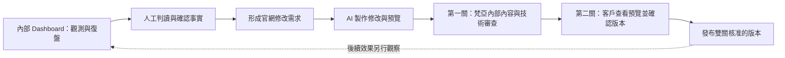
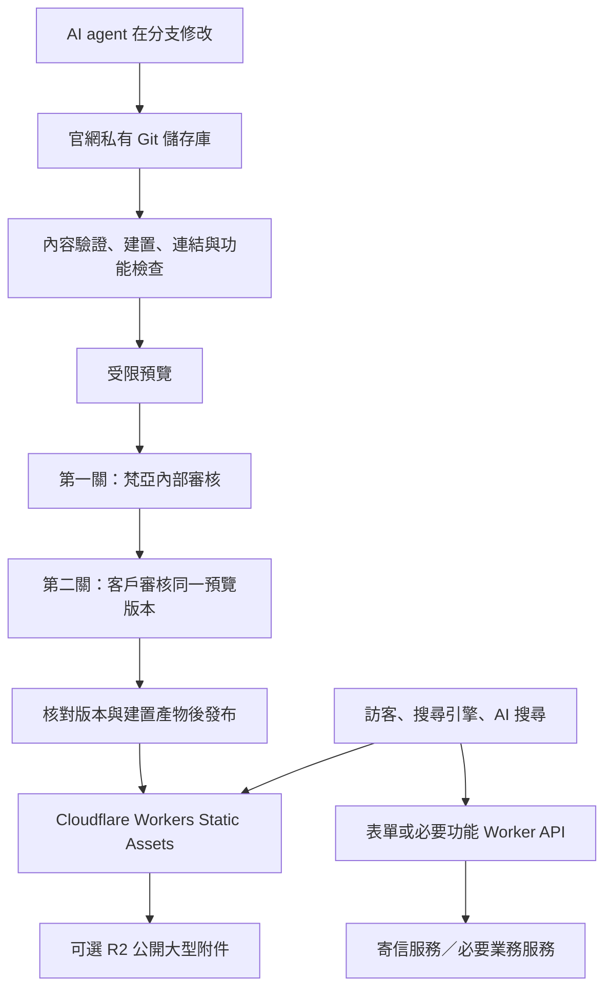

# AQUASKY 官網改版、Cloudflare 架構與 AI 維護整體規劃

文件日期：2026-09-24（Asia/Taipei）
討論對象：黃老闆／梵亞行銷有限公司
對象網站：<https://aquaskyplus.com/>
資料性質：內部決策與後續執行規劃；含內部監測摘要，存放於私有 GitHub 儲存庫。

> 本文件整合今天對話中的需求、澄清、網站與儲存庫盤點、登入後監測資料抽查、框架研究及 Roger 提出的語言問題。它是整理後的決策紀錄，不是會議逐字稿。已確認需求與研究建議分開標示；保存、commit 與 push 本文件不代表官網重建或正式部署已獲核准。

## 1. 決策摘要

建議將對外官網重建為 **Astro + TypeScript + Markdown／JSON 結構化內容 + Cloudflare Workers Static Assets**。公開頁面預先產生 HTML；詢問表單及必要計算功能另設小型動態服務。取消 CMS，以 AI agent 修改內容與程式，透過 Git、檢查、預覽、人工確認及部署完成更新。

本案價值是取得內容及維護自主性、改善版型、統一產品事實，並在保留既有 SEO 資產的前提下改善 AEO／GEO。**目前沒有證據顯示 PHP 本身造成 AI 誤認品牌；更換框架不能保證排名、引用或詢問量提升。**

核心原則：

1. 保留現有網域、重要網址及主要內容，改善版型與使用體驗。
2. 官網與內部 Dashboard 是兩個獨立系統；本次改版對象只有官網。
3. 經確認的品牌、產品與商業事實才可對外發布，監測答案不能直接成為官網事實。
4. SEO 是既有基礎，AEO／GEO 是同時要顧的公開內容與可讀性目標。
5. 不使用 CMS，但保留內容結構、版本、獨立預覽與回復能力；發布必須依序通過梵亞內部審核及客戶審核。
6. 先盤點與做代表頁試作，再確定完整搬遷範圍。
7. 繁中與英文提問需分開評估；目前繁中測試不能代表英文市場。

主估時情境是尚未取得原始備份、先由公開網站搬遷：**25–45 工作天，約 5–9 個工作週**。這是附條件的工程估算，不是固定報價或開工承諾；未知功能、選型公式與素材缺漏可能另增工作。加上原維護商回覆與客戶審閱等待，規劃日曆期間約 **10–14 週**，並在第 1 階段結束時設「繼續／調整／暫停」檢查點（第 12.1–12.2 節）。網站資產所有權與更換維護者的安排見第 8.4 節。

## 2. 今天對話的需求與結論

### 補充確認：重建的營運目的

黃老闆補充：現有 PHP 官網由另一位工程師維護，目前無法讀取其原始碼；CMS 累積多項業務與 SEO 設定，內容結構不一致，部分內容更新必須先由工程師改架構、開放後台欄位，團隊才能上稿。這是使用者描述的現況，尚未取得後端原始碼驗證。

重建的主要目的，是取得內容與維護自主性，降低每次行銷修改的協調成本。先把產品事實、語系文案、版型與資產結構化，再由 Agent 協助修改；圖片壓縮、尺寸轉換與連結檢查等重複工作交給固定工具執行。產品頁、比較內容與 JSON-LD 應共用已核准資料。原始碼、素材、內容、部署帳號與交接文件應由梵亞或客戶依約掌握，避免再次依賴單一維護者。

PHP／CMS 本身不是問題證據，更換技術也不保證 SEO／AEO／GEO 成效。現有 Cloudflare 外層補強無法取代原 CMS 與後端的控制權；前期整理仍需工程投入，後續才有機會縮短更新時間。快速上架指雙關核准後快速發布，不包含客戶審閱等待時間。

| 討論 | 使用者需求／已確認事項 | 整理後的處理方向 |
| --- | --- | --- |
| 專案儲存庫 | 以現有 AEO 專案作為研究與規劃的保存處 | 對應 `aquasky-edge-aeo-cloudflare` GitHub 私有專案 |
| 舊官網改版 | 使用者描述為舊 PHP 網站，希望現代化並放到 Cloudflare | 以內容型官網重建評估；PHP 框架名稱／版本尚未確定 |
| 保留程度 | 「保留網址與主要內容、改善版型」 | 不以全面改網址、刪文或重新命名產品為前提 |
| 原始資料 | 「目前不確定，先以公開網站估算」 | 公開資料搬遷為主情境，能否取得備份列為下一階段待辦 |
| 內容維護 | 不想再有 CMS，由 AI agent 協助修改 | 內容檔與 Git 為維護基礎，保留預覽與發布責任 |
| Astro／靜態與動態 | 希望了解原理 | 靜態頁仍能持續更新及有互動；動態服務只用於必要功能 |
| 決策依據 | 依監測中心持續累積的會議與觀測資料改善 | 先判讀證據，再提出官網修改需求與驗收指標 |
| 系統界線 | Dashboard 供對內討論、檢討、復盤；官網對外發布 | 兩者分專案、內容來源與部署，避免互相依賴 |
| 行銷目的 | 對外資訊需有利 AEO／GEO，同時顧既有 SEO | 可讀 HTML、可信資料、語系、URL、品牌辨識及內容意圖共同處理 |
| Roger 的問題 | 中文／英文提問是否影響 AI 取得的網站語言 | 有影響的可能與研究依據，但不是固定的同語言優先規則 |
| 本次交付 | 詳細整理文件，存入專案並 commit、push GitHub | 本文件為總入口，另保存五份研究依據；不因此啟動官網實作 |

## 3. 官網與內部 Dashboard 的界線

| 面向 | 對外官網 | 對內 Dashboard |
| --- | --- | --- |
| 對象 | 潛在客戶、採購者、合作夥伴、搜尋引擎與 AI 搜尋服務 | 黃老闆、客戶內部與執行團隊 |
| 任務 | 發布品牌、產品、技術、應用與合作資訊，取得有效詢問 | 保存觀測、討論、檢討、復盤與決定後續行動 |
| 內容 | 已確認、可公開且有依據的資料 | 原始回答、疑點、事件、未定案討論及內部成效 |
| 技術關係 | 自有內容、建置與部署；不依賴監測 API 顯示頁面 | 自有登入、監測資料與維運流程 |
| 本次範圍 | 改版規劃主體 | 決策參考，不納入官網改版功能 |

建議官網另建私有儲存庫，例如 `aquasky-website`；名稱尚未定案，尚未建立。本儲存庫保留既有 AEO 補強、監測與研究歷史。未來官網建置輸出不得包含內部報告、客戶報價、登入資料或監測原始答案。

兩者的連接方式是工作流程：



圖中的箭頭代表人員與工作流程，不表示兩套系統已串接 API，也不表示監測資料會自動寫進官網。

## 4. 已盤點的網站與儲存庫

### 4.1 GitHub 儲存庫的性質

目前儲存庫為 Edge AEO 補強與監測專案，**不是完整 PHP 官網原始碼**。

- `worker/src/index.js` 向來源站取得頁面，再補強 HTML，採 fail-open 設計。
- `worker/wrangler.toml` 有六語系路由；監測另有 Worker 與 D1。
- 已列舉的未壓縮檔案未見 PHP 官網原始碼或 `composer.json`；倉庫內 RAR 尚未解包檢查。
- 監測 SQL 不能視為官網內容資料庫。
- `worker/data/product-urls.json` 有 96 筆英文產品／配件網址。
- README 混有早期計畫與後續紀錄，不能只用其中「待部署」字樣判斷現在正式站狀態。

### 4.2 公開網站抽樣結果

以下為 2026-09-24 的公開網站盤點，不是全站逐頁驗收。

| 項目 | 觀察結果 | 限制 |
| --- | --- | --- |
| 主 sitemap | 791 筆 `<loc>` | 尚未逐筆去重及驗證，不能稱為 791 個有效獨立頁面 |
| 文章明細 | 479 筆：英文 186、中文 49、西／法／俄／阿各 61 | 各語系內容不對稱，不能假設全為一一翻譯 |
| 影片明細 | 66 筆：六語系各 11 | 尚未驗證播放及嵌入設定 |
| 英文產品／配件 | 90 + 6 = 96 筆 | sitemap 未列其他語系明細，不足以證明不存在 |
| 其他網址條目 | 150 筆 | 待細分首頁、系列、公司、列表與功能等 |
| 中文聯絡頁 | POST 至 `contact.php`，含姓名、email、電話、留言及驗證欄位 | 未提交，未驗證寄送與儲存 |
| 選型工具 | 三類入口：System Pressure Switch、VSD(VFD)、Thermal Expansion Tank | 未確認公式、輸入範圍與等價輸出 |
| 下載中心 | 有多語附件入口 | 檔案數、大小、版本、完整性與使用權待清點 |

791 = 479 + 66 + 96 + 150，只是條目分類核對。它不等於 791 個獨立版型；初估可能由約 10–14 種共用頁型產生，但仍需完整盤點確認。

仍未知的項目：PHP 框架與資料庫版本、隱藏功能、原始媒體、表單服務、選型公式、完整成本與流量基準。公開 HTML 無法還原後端原始碼、資料庫及未公開功能。

公開站來源：[sitemap](https://aquaskyplus.com/sitemap.xml)、[首頁](https://aquaskyplus.com/en)、[聯絡頁](https://aquaskyplus.com/zh/contact)、[選型工具](https://aquaskyplus.com/en/sel_tools)、[下載中心](https://aquaskyplus.com/en/downloadpage)。更完整證據見[搬遷初評](research/2026-09-24-migration-assessment.md)。

後續若進行完整擷取，應遵守本專案[對站台請求行為準則](19-對站台請求行為準則.md)，使用既有請求工具、自我標示身分與節流；本次尚未全站爬取或匯出。

## 5. 監測資料對官網優先順序的影響

指定參考來源：[內部監測中心](https://aquasky-monitor.cloundflare1.workers.dev/)。黃老闆登入後，今天以唯讀方式檢視相關頁籤、重點答案及部分警示。以下皆為當時快照，不代表此文件開啟時的最新數字。

| 證據／時間 | 觀察 | 對官網的意義與限制 |
| --- | --- | --- |
| 9/22 完整十二問 × 六模型 | 共收到 72 筆；無品牌提示 30 筆中 11 筆提及；有品牌提示 42 筆中 41 筆附官網 | 已知品牌時的官網可找到性有基礎；陌生需求下的發現值得改善。提及不等於推薦，引用不等於正確 |
| 9/22 品牌比較題 A3 | 0/6 提及，其中 1 筆僅開場白 | 值得查選型／比較內容，但不能解讀為六個完整評估均排除品牌 |
| 9/24 重點複查 | 四題 × 六模型，23/24 非截斷答案，1 筆失敗／待處理；仍待人工複核 | 題組與 9/22 不同，Claude 型號也更換，不能直接比較兩輪總分 |
| 9/24 09:15:48，Perplexity B7 | 保固答案仍主要談 Fluval AQUASKY LED 燈具 | 同名品牌辨識是優先問題；尚不能由此確定官網何處造成錯誤 |
| 9/24 09:10:48，Perplexity B6 | 表示未找到明確經銷條件、MOQ 與標準交期；引用含舊 PHP 多語 URL | 應核對可公開的合作資訊；AI 說未找到不等於網站一定沒有 |
| 9/24 11:41–11:42 UI 快照 | 保存至 11:30，85 項需查看；0 失敗、14 部分收集 | 事件數不是獨立故障數，不能據此認定網站故障 85 次 |
| 8/21–9/20 歷史流量區 | 31/31 日紀錄，0/31 日安全事件細節，最近全站完整驗證為 8/17 | 歷史證據缺口與即時收集分開看，不能互相補成通過 |

B7 原題只點名 AQUASKY，未明說壓力桶。它可以觀察自然品牌辨識，但不是官網內容缺漏的因果測試。若增加「壓力桶」提示，應另列診斷題，保留原題作可比較基準。

目前合理的內容優先順序是：公司與品牌身分 → 產品與保固事實 → OEM／ODM／經銷合作條件 → 選型與比較。所有效能、認證、MOQ、交期及保固數字都需客戶確認，不能從 AI 答案推定。

本次未核查全 72／24 筆答案、全部事件根因、Search Console、真人流量與有效詢問。詳見[依監測資料修訂的架構評估](research/2026-09-24-monitor-informed-architecture.md)。

## 6. Astro、靜態網站與動態網站的意思

**Astro 是製作網站的框架。** 本案建議讓它在發布前，把內容與版型組成可直接送出的 HTML。

可以把靜態頁想成預先印好的型錄：讀者來時直接取閱；資料更新後，重新製作並發布新版。它仍可經常更新，也可以有選單、搜尋介面、影片與計算器。

動態網站則像收到需求才現場整理資料：例如登入後顯示個人訂單、查即時庫存，或由伺服器處理詢問表單。動態不代表視覺比較活潑，靜態也不代表內容永遠不變。

Astro 能做靜態輸出，也能按需求加入伺服器渲染；本案選的是**公開內容預先產生、少量功能按需動態處理**。取消 CMS 是維護方式的選擇，與是否使用資料庫／後端不是同一件事。

## 7. 框架選擇與未來技術架構

### 7.1 選擇判斷

| 方向 | 本案適用性 |
| --- | --- |
| Astro | 首選。適合產品、公司、文章、下載等內容頁，搭配內容檔及局部互動 |
| SvelteKit | 若後續確認有大量互動工具、複雜表單或應用流程，再作備選 |
| Next.js 生態 | 若團隊已有大量相關投資，或新增會員、報價入口等應用需求，再評估部署相容性與維護成本 |
| 繼續 PHP | 技術上仍可做好 SEO／AEO；如果只修內容可短期沿用，但不完全符合此次取消舊 CMS、改用內容檔維護的方向 |

選擇 Astro 的原因是本案功能與維護模式相符，不是 AI 搜尋偏好某個框架。Cloudflare、框架與套件的實際版本將在試作時鎖定並驗證。2026-09-24 查核結果及其他路線的時效限制見[框架研究](research/2026-09-24-framework-options.md)。

### 7.2 建議部署組成



| 元件 | 職責 | 第一階段原則 |
| --- | --- | --- |
| Astro | 頁面與共用版型，預先產生 HTML | 主內容不用等 JavaScript 才看得到 |
| TypeScript／內容 schema | 驗證欄位、資料引用與程式型別 | 驗格式與一致性，不取代事實審核 |
| Markdown | 文章、應用、FAQ、公司與合作說明 | 清楚標示 URL、語系、日期、來源與狀態 |
| JSON | 產品共同規格、品牌事實、資產與路由對應 | 規格供正文與 JSON-LD 共用 |
| Workers Static Assets | 發布公開頁面、圖片與一般附件 | 純靜態 Astro 不需要 Cloudflare adapter |
| Worker API | 表單驗證、限流、寄信及必要動態邏輯 | 不預設全站 SSR；機密只放受控設定 |
| Turnstile | 視需要降低表單濫用 | 使用時必須伺服器端驗證，不只放前端元件 |
| R2 | 視容量及單檔限制存大型公開附件 | 先盤點，非第一版必備 |
| Git／CI | 差異、版本、檢查、預覽與發布 | 預覽分支與正式發布分開設定 |

Workers 不是原 PHP 主機的直接替身。本案會重建輸出與必要功能，不是把 PHP 資料夾原封上傳就能運作。寄信服務、附件容量、API 量與選型工具尚待盤點，因此不承諾零月費。

### 7.3 官網目錄建議

以下只是未來新官網的設計範例，今天沒有建立這套程式：

```text
aquasky-website/
  AGENTS.md
  src/
    components/          共用 UI
    layouts/             共用頁型
    pages/               保留既有公開路徑的頁面產生邏輯
    content/             文章、公司、合作、FAQ 等語系內容
    data/
      products/          穩定產品 ID 與共同規格
      brand/             已確認品牌事實
      routes/            舊 URL、目標 URL 與狀態對照
      assets/            圖片／PDF 的來源與引用對照
  public/                適合直接發布的公開資源
  services/              必要的表單／功能 API
  scripts/               搬遷及檢查工具
  docs/                  內部操作與發布紀錄，不納入公開輸出
```

## 8. 內容資料設計與 AI 維護規則

### 8.1 內容資料模型

| 資料 | 建議欄位 | 避免的問題 |
| --- | --- | --- |
| 產品 | 固定 ID、型號、系列、規格值與單位、適用條件、附件、來源、核准狀態 | 六語系數字不一致、型號改名造成網址變動 |
| 語系文案 | 產品 ID、語言、名稱、描述、應用、限制、固定 URL、SEO 欄位 | 逐字翻譯失去採購用語，或用改標題偷偷改網址 |
| 商業事實 | 事實內容、適用市場／型號、來源文件、核准人／日期、需複查時間 | 虛構 MOQ、交期、認證、保固與性能 |
| 文章 | 原 URL、語言、標題、日期、本文、圖片與相關產品 | 搬遷後丟失內容、日期、連結與來源 |
| 資產 | 固定 ID、舊 URL、新位置、語言、版本、使用權與檢查狀態 | 下載斷鏈、舊新版混用 |
| 路由 | 原路徑及 query、目標、200／導向／其他處置、理由、驗收 | 全部導回首頁或遺漏舊 PHP 參數網址 |

規格等共同事實採同一來源；不同市場若有真實差異，須明確表示適用範圍，不強迫做成相同內容。六語系現有內容先保留盤點，不預設補寫成六套完全相同頁數。阿拉伯文另驗 RTL。

### 8.2 日常修改流程

1. 黃老闆提出需求，列出相關頁面、目標與依據。
2. AI 讀取專案規則及已核准資料，辨識哪些事實仍不足。
3. 在限定分支修改內容或元件，保留 URL，避免夾帶無關變更。
4. 執行適當檢查：內容欄位、建置、連結、SEO、多語及受影響功能。
5. 產出預覽與差異摘要：改了什麼、為什麼、檢查結果、未確認事項。
6. 第一關由梵亞內部確認內容、品牌表達、版面、事實依據與技術檢查；通過後才送客戶。
7. 第二關由客戶查看獨立預覽頁及修改摘要，確認具體版本或提出修改。兩關皆通過後，才合併及發布同一核准版本，保存 commit、核准紀錄與發布時間。
8. 線上驗證相關頁面／功能，失敗時回復已知良好版本。

例如「更新某產品中文介紹與 PDF」只需改文案與附件引用，再建置發布，不需登入 CMS。若規格來源不足，AI 應列待確認，不自行補數字。

`AGENTS.md` 應規定可改範圍、資料來源、必要檢查、禁止機密入 Git、發布與回復方式。第一階段不必建常駐自主發布 agent；先讓每次修改可審查、可追蹤、可回復。私有 GitHub 的分支保護與審核功能須核對方案及實際設定，尚未設定完成。

### 8.3 客戶預覽與雙關審核（已確認需求，尚未實作）

Dashboard 可以提出方向，Agent 可以先製作修改，但不得因此直接更新正式官網。黃老闆要求的「圖紙化」採可瀏覽的臨時預覽頁呈現：客戶直接查看文字、圖片、排版、手機效果及受影響互動，不必閱讀程式碼。

狀態流程：**草稿 → 內部待審 → 客戶待審 → 已核准待發布 → 已發布**。

- 每次送審提供預覽網址、版本識別、修改前後摘要、原因、檢查結果與待確認事項；內部討論及機密不放入客戶預覽內容。
- 預覽環境限制存取並避免搜尋索引，清楚標示尚未發布；表單測試與正式收件流程隔離，避免產生非預期業務通知。
- 梵亞通過後才送客戶；客戶可確認該版本或提出修改。退回後由 Agent 修訂，再走梵亞與客戶兩關，不能沿用舊版核准。
- 核准紀錄至少保存審核人、時間、版本／commit、預覽及確認範圍。預覽網址不能在核准後悄悄指向不同內容；新修改產生新版並重新審核。
- 正式發布以已核准的程式、內容與資產版本為準，優先使用相同建置產物，避免重新複製貼上。若因環境設定需重建，必須核對版本及輸出差異；任何影響送審內容的差異都需重新送審。
- 發布入口必須檢查兩關核准及版本一致性，Agent 不可自我核准或略過審核。保存發布與回復紀錄，上線後驗證受影響頁面及功能。

審核人的指定、確認紀錄的保存方式與介面工具於試作時定案；不預設必須開發完整審批系統。先用一筆真實修改驗證送審、退回、再審、發布及回復流程。客戶等待與修改往返另列排程，不以工程工作天保證曆日交期。

### 8.4 所有權、客戶參與與更換維護者（建議方向，待合約確認）

取消 CMS 後，AQUASKY 同仁不再直接登入後台修改；若沒有相應安排，只是把依賴對象從原工程師換成梵亞，與第 2 節「避免再次依賴單一維護者」的目的矛盾。本節說明如何處理這個取捨。以下為建議，實際歸屬與權限須寫入合約並經客戶同意。

**資產所有權**

| 資產 | 建議歸屬 | 梵亞角色 |
| --- | --- | --- |
| 網域與 DNS | 維持客戶名下 | 依授權協助設定，不取得轉移權 |
| Cloudflare 帳戶／官網資源 | 客戶名下帳戶，或合約明定可隨時移轉 | 以成員權限部署與維運 |
| 官網 Git 儲存庫 | 客戶組織名下的私有儲存庫 | 協作者；權限隨合約調整 |
| 內容檔、產品資料、圖片與 PDF 原檔 | 客戶 | 整理、結構化與維護 |
| 程式、版型與 `AGENTS.md` 等維護規則 | 依合約約定授權或移轉；建議至少保證客戶可持續使用與修改 | 開發與更新 |

帳號密碼與 API 金鑰不放入 Git，以客戶可控的方式保存，並列出清單與負責人。

**客戶可以怎麼參與**

1. 以固定管道（例如需求表單或指定信箱）提出修改：頁面、內容、依據與期望上線時間。
2. 由 Agent 產生預覽，經梵亞第一關後送客戶第二關；客戶看的是網頁，不需要讀程式。
3. 產品事實、規格、保固與合作條件以客戶提供的資料為準，並保存來源與核准紀錄。
4. 內容檔為可閱讀的 Markdown／JSON，客戶可隨時查看目前線上內容對應的資料與修改歷史。
5. 若日後客戶希望自行修改文字，可再評估在 Git 網頁直接編輯或加上輕量的 Git 內容編輯介面；仍須產生預覽並經審核後發布，不回到直接改正式站的方式。第一版不預設建置。

**更換維護者或終止合作時**

- 網站使用開源框架（Astro）與標準 Git 流程，沒有梵亞專屬後台；其他熟悉前端的工程師或 AI agent 可依儲存庫文件接手。
- 交接包至少包含：儲存庫與完整歷史、內容與素材原檔、`AGENTS.md` 與操作手冊、部署與回復步驟、帳號與服務清單、表單收件設定、最近一次核准與發布紀錄。
- 合約應約定交接期間、權限移轉程序與協助範圍，避免重演目前無法取得原始碼的情況。

這些安排讓「由梵亞以 AI 快速維護」成為服務選擇，而不是技術上的綁定。

## 9. SEO、AEO／GEO 與公開內容策略

本文件以 SEO 表示搜尋可找到性及既有自然搜尋資產；AEO／GEO 表示答案／生成式搜尋中的可找到、正確理解與引用機會。三者共用不少基礎，不應拆成互相矛盾的內容。

### 9.1 技術與內容要求

- 產品用途、規格、限制與重要答案直接存在初始 HTML。
- 保留有效舊 URL、內部連結、canonical、hreflang、sitemap 與下載入口。
- 公司名稱、品牌、領域、產品關係及官方連結一致，協助降低同名品牌混淆。
- 規格、認證、售後及合作條件有來源與適用範圍；不能為增加引用而編造。
- 正文與 JSON-LD 使用同一份核准資料；結構化資料不能藏入正文沒有的優勢或評價。
- 選型內容回答採購問題，包含適用／不適用條件、差異、證據及下一步。
- 先改善既有相關頁面；確認有獨立需求才新增，不為每個問法複製一頁。
- 合法搜尋爬蟲、使用者觸發讀取與訓練用途分開考量；核對 robots、WAF 與真正回應內容。
- 預覽站受限且避免索引；正式站檢查沒有遺留 noindex 或登入限制。
- `llms.txt` 或特定 schema 不列為被引用保證；框架本身也不是 AEO 成效指標。

現有 AI 爬蟲政策先盤點保留，任何變更須依已確認的業務決策處理，不因重建擅自改成全面放行或封鎖。

### 9.2 成效分四層

| 層次 | 觀察指標 | 不能替代的指標 |
| --- | --- | --- |
| 存取 | 指定合法請求是否取得正常正文、狀態與可索引內容 | 不能代替 AI 引用或推薦 |
| AI 回答 | 品牌提及、正確辨識、正確事實、官網引用 | 不能當真實全球曝光或排名 |
| 真人流量 | 可辨識的自然搜尋與 AI referral／UTM 造訪 | 不能等同有效詢問 |
| 商業結果 | 實際送達、去重、業務認定可跟進的詢問 | 不能用表單按鈕點擊替代 |

Search Console、網站分析與業務詢問資料尚未讀取。後續以實際帳號可用欄位建立基準，不預設報表／API 已提供所有想要的數據。沒有資料的項目標「目前資料不足」，不填成零。

每次觀察保留日期／時區、平台、模型、題目、語系、模式、完整性與網站版本。同時記錄其他行銷活動，避免把前後差異全部歸功於改版。完整官方依據見[AEO／GEO 要求研究](research/2026-09-24-aeo-geo-requirements.md)。

## 10. Roger 的語言問題與雙語測試方案

### 10.1 判斷

**提問語言可能改變搜尋與引用來源分布，但沒有足夠依據說所有 AI 都固定「繁中先找繁中、英文先找英文」。**

需要分開觀察四種語言：使用者提問 → AI 實際搜尋字串 → 被取得／引用的文件 → 最後回答。繁中回答不代表主要讀繁中網站；繁中提問也不保證排除簡體中文。若未啟用搜尋，更不能把答案當作剛剛抓取網站的結果。

來源與界線：

- Google 表示查詢語言是重要因素，但內容是否有用、地點及設定也會影響，結果可以跨語言。這是 Google 搜尋說明，不是所有 AI 的共同規則。[官方說明](https://support.google.com/websearch/answer/13511324?hl=en)
- ChatGPT 搜尋會把提問改寫為一個或多個查詢；官方未承諾固定中英文來源順位。[OpenAI 說明](https://help.openai.com/en/articles/9237897-searching-the-web-with-chatgpt)
- Perplexity Search API 有語言篩選與獨立國家參數，但這不能證明消費者介面自動依提問套用相同限制。[API 文件](https://docs.perplexity.ai/api-reference/search-post)
- 原始多語言檢索研究觀察到同語言配對偏好，另有研究發現英文與提問原語言的排序偏好；皆不能直接外推目前六個商業平台的固定行為。[Park 等人](https://aclanthology.org/2026.findings-acl.1353/)、[Wang 等人](https://aclanthology.org/2026.acl-long.338/)

今天 B6 繁中題目的引用清單已出現 `lang=en` 及其他語系網址，可作跨語系引用線索。但 URL 語系參數不是每頁實際正文語言的完整驗證，也不能用引用清單反推出先查哪種語言。

### 10.2 對現有測試的解讀

既有繁中題組仍有價值，應保留原題及歷史基準；它衡量的是這組繁中問題在指定條件下的表現。它不能單獨代表英文採購者或全球市場，也不能據此把現有錯誤直接歸因於中文提問。

### 10.3 建議測試設計（尚未執行）

1. 選定核心採購與品牌辨識題，保留現有繁中版本。
2. 製作語意、採購條件與品牌提示程度相同的英文版本，人工核對專有名詞。
3. 固定平台、模型／模式、搜尋設定、地區及可控的個人化條件；記錄無法控制項。
4. 在獨立對話、接近的時間交錯執行兩種語言；重複數輪，避免單次隨機結果定論。
5. 無品牌提示、有品牌提示、加上壓力桶的診斷題分組，不混為同一基準。
6. 保存原始答案、完整性、實際引用 URL、頁面語言及可見的搜尋字串；看不到則標未知。
7. 分平台及語言報告品牌提及、辨識正確、事實正確與官網引用；同時保留失敗數及清楚分母。
8. 若之後要改測試排程或增加 API 呼叫，另確認執行範圍與預算；本次未觸發測試。

示例：

> 繁中：請推薦適合住宅加壓供水系統的壓力桶品牌，並比較選購重點。
> 英文：Recommend pressure tank brands for residential water booster systems and compare the key purchasing considerations.

將中文答案翻成英文不算英文提問測試。英文不等於美國，繁中也不等於台灣；市場、所在地及語言要分別記錄。

官網因此應提供足夠且一致的英文與繁中資訊；若海外採購為主要客群，優先完善英文規格、選型、應用、OEM／經銷合作與保固，並保留其他既有語系。這影響內容策略及測量方法，不構成更換 Astro 的理由。詳見[語言研究](research/2026-09-24-query-language-primary-sources.md)。

## 11. 到底會改多少

這次是底層重建、內容搬遷與版型改善，沒有依據可用單一百分比表示。

| 層面 | 保留方向 | 修改幅度 |
| --- | --- | --- |
| 網域與公開 URL | 盡量原樣保留 | 路由實作重建，必要差異逐筆導向 |
| 品牌與主要內容 | 保留已確認事實及有效內容 | 儲存格式全面轉換，部分內容補證據與改善表達 |
| 前台版型 | 保留品牌辨識 | 共用頁型、導覽、手機版與元件大幅重做 |
| PHP／CMS | 不沿用 CMS 維護方式 | 公開頁面產生邏輯全面替換 |
| 圖片／PDF／影片 | 保留可用資產及連結關係 | 盤點、搬移、對照與缺漏修補 |
| 表單 | 保留有效詢問目的 | API、驗證、寄信與狀態重建 |
| 選型工具 | 保留經確認的邏輯與結果 | 取得公式後決定保留或重寫，現階段工作量未知 |
| AEO Worker | 保留必要能力 | 新站原生輸出後逐項解除重複 HTML 注入 |
| 防護與監測 | 核對後延續 | 路由及驗收目標更新；Dashboard 不重寫 |
| 維護流程 | 保留內容責任 | CMS 操作改為 AI／Git／預覽／確認／發布 |

## 12. 分階段執行步驟、交付與工期

以下是建議計畫，尚未開工。估算假設一位熟悉此架構的工程執行者搭配 AI，素材可取得，客戶適時回覆。

| 階段 | 工作與交付 | 完成門檻 | 工作天 |
| --- | --- | --- | ---: |
| 1. 完整盤點 | URL、語系、頁型、附件、表單、選型、舊路由、主機相依及 SEO 基準清冊 | 明確分已取得、缺漏、待確認與不保留項 | 2–4 |
| 2. 代表頁試作 | 首頁、系列、產品、文章；中英與阿拉伯版型；一條表單及工具技術檢查 | Cloudflare 預覽可用，URL／內容／schema 一致，完成一次 AI 更新流程 | 3–5 |
| 3. 共用版型及內容搬遷 | 約 10–14 類頁型、六語系實際資料、附件、URL 對照與缺漏報告 | 核准範圍逐筆可追蹤，代表性視覺及內容檢查完成 | 8–14 |
| 4. 功能及搜尋整合 | 表單、已確認工具、導向、canonical、hreflang、schema、sitemap、追蹤 | 功能結果有實證，搜尋設定與舊站對照完成 | 4–7 |
| 5. 驗收及切換 | 修正、設定備份、回復演練、切換與線上驗證 | 發布清單通過，回復路徑可執行 | 3–5 |
| 有完整可用資料時合計 | 不含等待及追加功能 | 約 4–7 工作週 | **20–35** |
| 公開資料抽取及核對加量 | 適用目前原始備份不確定情境 | 視取得完整度調整 | **+5–10** |
| 本案主情境合計 | 初步工程估算，非固定交期 | 約 5–9 工作週 | **25–45** |

上線後另安排 2–4 週觀察，不代表每天投入一整天，也不代表 AEO／SEO 效果必然在此期間穩定。大量缺圖、隱藏功能、重譯及無公式的工具可能超出估算。

### 12.1 預估日曆期間（規劃假設，非交期承諾）

25–45 工作天只計工程投入。實際從啟動到切換，還會等待原維護商、客戶審閱與事實確認。以下以常見節奏推估，供排程與對客戶溝通使用：

| 等待項目 | 假設 | 對日曆期間的影響 |
| --- | --- | --- |
| 原維護商回覆備份／公式 | 與第 1 階段並行；回覆需 1–3 週 | 若第 1 週未取得回覆，搬遷範圍與選型工具工作可能延後 |
| 客戶審閱 | 至少 3 輪：代表頁、搬遷批次、切換前驗收；每輪 3–5 工作天含一次修改往返 | 約增加 2–3 週 |
| 商業事實確認 | 保固、MOQ、交期、認證等，與搬遷並行 | 未確認項目以「待確認」上線或延後相關頁面，不阻擋全站 |
| 內容凍結 | 切換前 1–2 工作天 | 已含在工程估算 |

**規劃基準：約 10–14 週（約 2.5–3.5 個月）。** 若備份與公式可在第 1 週取得、客戶每輪審閱在 3 工作天內完成，最快約 8 週。遇到大量缺圖、需要重譯或選型公式需重建時，應在檢查點重新估算，而不是在後段壓縮驗收時間。

### 12.2 第 1 階段結束的「繼續／調整／暫停」檢查點

完整盤點（第 1 階段）結束時，由黃老闆與客戶共同檢視以下項目，再決定是否進入代表頁試作與正式搬遷：

| 檢查項目 | 繼續的條件 | 未達成時的處理 |
| --- | --- | --- |
| 原始備份 | 已取得，或確認只能用公開網站搬遷並接受加量 | 採公開資料主情境，工期維持 25–45 工作天上限區間 |
| 選型工具公式 | 已取得公式與已知案例，或同意第一版先改為詢價／聯絡導向 | 選型工具另列專案，不讓它拖住全站 |
| URL 與附件清冊 | 已完成並確認不保留項目 | 補齊前不確定搬遷批次與切換日期 |
| 附件總量與單檔大小 | 已知並符合 Static Assets 限制，或決定使用 R2 | 補列 R2 成本與流程 |
| 客戶審核人與事實確認人 | 已指定，且同意審閱回覆節奏 | 無法指定時暫緩送審流程，先做內部試作 |
| 所有權與交接安排（第 8.4 節） | 客戶同意帳戶與儲存庫歸屬 | 合約定案前不建立正式帳戶資源 |

檢查點可能得到三種結果：

- **繼續**：依原計畫進入第 2 階段。
- **調整**：縮小第一版範圍，例如先改舊站的品牌與合作內容、延後選型工具或部分語系。
- **暫停**：關鍵資料或授權無法取得時，先在舊站做可行的內容改善，保留盤點成果，待條件成熟再重啟。

檢查點的結論與日曆期間應寫成新紀錄保存，不覆寫本節的初估。

### 第一批優先工作包

| 優先 | 工作 | 產出 |
| --- | --- | --- |
| P0 | 重要頁可讀性、URL 與 SEO／詢問基準 | 確認問題與缺資料，不把收集失敗當網站故障 |
| P1 | 品牌身分、產品及保固事實 | 核准的中英文資料與可公開來源 |
| P1 | OEM／ODM、經銷合作條件 | 可公開的條件與適用範圍；需個別詢價者列所需資料 |
| P2 | 代表系列選型／比較 | 有來源的用途、限制、差異及相關頁面 |
| P2 | Astro 代表頁試作 | 保留 URL、共用事實、預覽與 AI 更新驗收 |
| P3 | 全站搬遷與切換 | 清冊驗收、部署、回復及持續觀察 |

若舊站可修改，可先改善已確認的品牌與合作內容，無須等全站完成；若原廠限制更新，則將其作為新站代表頁。任何短期修正仍需明確確認實際執行範圍。

## 13. URL、既有 AEO Worker 與切換方案

### 13.1 過渡排程與內容同步

採「舊站持續營運、新站獨立建置，雙關審核與驗收後切換」。主情境仍為 25–45 工作天，約 5–9 工作週；下表是可重疊的規劃窗口，不可把各列週數相加，也不是固定交期。

| 階段 | 規劃窗口 | 過渡工作 |
| --- | --- | --- |
| 盤點與範圍確認 | 第 1 週 | 確認 URL、素材、多語、表單、選型公式及主機相依；舊站照常營運 |
| 架構與代表頁 | 第 2–3 週 | 建立代表版型，走完 Agent 修改、梵亞審核與客戶預覽確認 |
| 搬遷與功能重建 | 第 3–6 週 | 批次整理內容、圖片、SEO 與必要功能；預覽限制存取 |
| 驗收與最後同步 | 第 5–8 週 | 核對 URL、附件、多語、手機與表單送達，補入施工期間舊站更新 |
| 正式切換 | 第 5–9 週內，依完成情況 | 兩關核准及驗收後，選低流量窗口切換並立即驗證 |

以上以資料可取得、範圍受控及及時回覆為前提；等待原維護商、客戶審閱及追加修改另計。含等待的日曆期間見第 12.1 節（規劃基準約 10–14 週）。第一週優先釐清選型工具公式與未公開功能，再縮小估時及確認切換日期。

切換前以舊站正式內容為基準，新站改善內容另列草稿；建立施工期間更新紀錄，保存頁面、修改日期與同步狀態。切換前建議安排 1–2 個工作天內容凍結，暫停一般編輯但維持網站對外服務；緊急更新同步兩邊，若改到送審版本則重新取得核准。最後同步完成後再鎖定切換版本。

切換後以新站流程管理正式內容，避免雙邊持續編輯。先安排約 2 週密集觀察，依問題延長至既有規劃的 2–4 週；不代表 SEO／AEO 成效已穩定。舊站環境建議受限保留 2–4 週，直至切換驗收、觀察及回復準備完成；確認郵件等相依後才退租。期間需保存新收到的詢問，回復舊站時不得遺失切換後的業務資料。

### 13.2 切換與回復檢核

1. 建立來源 URL → 目標 URL → 狀態碼 → 對應內容的清冊；含目前網址、舊 PHP query URL、下載入口及 sitemap。
2. 可以保留的網址直接供應正確內容；真正改址才做對應永久導向，不全部導向首頁。
3. 對 `.php?sid=...&lang=...` 類網址驗證參數意義；Static Assets `_redirects` 無法按 query 條件比對時，用 Worker 或合適規則實作。
4. 新站自行產生 canonical、schema 及 sitemap 後，逐項停用舊注入，避免重複、矛盾與覆寫。
5. 上線前備份 Cloudflare Routes、來源站設定、Redirects、WAF、DNS 及 Worker 版本，確認新舊路由優先關係。
6. 最後同步版本經梵亞及客戶兩關核准、驗收通過後，於確認的變更窗口切換；立即檢查首頁、產品、文章、語系、下載、導向與表單。
7. 明訂回復條件：重要內容錯誤／大範圍失效、錯誤導向、表單中斷或其他阻斷主要用途的問題；回復已知良好版本及相符路由，再調查。
8. 舊站以受限方式保留至切換驗收及觀察完成，確認備份可用後再安排退場。

**`AEO_ENABLED=false` 只代表停止 AEO 改寫，不是整個新官網的回復操作。** 整站回復要能恢復舊來源站與 Cloudflare 路由，且內容、資產及 AEO 規則相容。

先確認舊主機是否另提供 email 或其他服務，再決定退租；網站切換不得誤改郵件 DNS。靜態頁留原 PHP 外觀的 URL 不代表必須繼續執行 PHP。

依據：[Google 不改網址搬遷](https://developers.google.com/search/docs/crawling-indexing/site-move-no-url-changes)、[改網址搬遷](https://developers.google.com/search/docs/crawling-indexing/site-move-with-url-changes)、[Cloudflare 導向限制](https://developers.cloudflare.com/workers/static-assets/redirects/)。

## 14. 驗收標準

以下為未來工程驗收，**目前均不能視為已通過**。

| 項目 | 最低驗收證據 |
| --- | --- |
| URL 完整度 | 核准清冊每筆有處置；狀態、內容、導向符合預期，無不預期 404／迴圈／多跳 |
| 內容完整度 | 主要正文、型號、規格、圖片、影片及下載對照完成；缺漏清楚列出 |
| 多語 | 語系導覽、對應關係、canonical／hreflang 合理；無錯配翻譯，阿拉伯文 RTL 實測 |
| 版型 | 手機與桌面代表頁可用；鍵盤導覽、標題結構、替代文字與對比適當 |
| 表單 | 成功／失敗／重複提交可辨識，指定收件匣實際收到，濫用防護有效 |
| 選型工具 | 以客戶／工程人員提供的已知輸入輸出案例確認，不以畫面相似宣稱等價 |
| SEO／AEO | 正文可讀、schema 相符、sitemap 有效、索引與爬蟲設定正確，無重複注入 |
| 部署隔離 | 公開建置不含內部 Dashboard、討論、秘密或客戶報價 |
| AI 維護 | 一筆真實內容修改走完分支、檢查、預覽、梵亞審核、客戶審核、發布與線上驗證；核准版本與發布版本一致 |
| 審核退回 | 退回後產生新版，舊核准不適用；缺任一關核准或版本不符時不能發布 |
| 客戶預覽 | 桌面與手機可查看受影響頁面；存取受限、避免索引，審核紀錄可追溯 |
| 過渡同步 | 舊站更新紀錄、最後同步與凍結窗口有紀錄；新站切換與舊主機退場分開執行 |
| 回復 | 可實際回復前一版本及必要路由，備份可取得且流程明確 |
| 成效基準 | 發布時間與 commit 可對照；技術通過與商業效果分別記錄 |

檢查狀態使用通過、失敗、未執行、待確認；沒有執行的測試不得標通過。新站效能需建立實測基準，不先承諾分數。

## 15. 風險、成本與待確認資料

| 項目 | 現況／影響 | 下一步 |
| --- | --- | --- |
| PHP／資料庫／上傳備份 | 取得狀況不明，影響完整性與工期 | 向原維護商詢問可交付項目與格式 |
| 選型公式 | 尚未驗證，可能有專業邏輯與邊界條件 | 取得程式、公式、單位與已知案例，由工程人員確認 |
| 素材與下載 | 數量、容量、版本與授權未知 | 建附件清冊，決定 Static Assets 或 R2 |
| 商業事實 | 保固、MOQ、交期等需核對 | 指定客戶確認人及可公開範圍 |
| SEO 基準 | 尚未讀取 Search Console／分析 | 取得必要唯讀資料，記錄重要 URL 與查詢 |
| 表單及信件 | 未實測現行送達及服務相依 | 確認收件人、寄信服務、必要儲存與保存需求 |
| 原主機相依 | 郵件或其他服務是否共用未確認 | 完成相依盤點後才退租 |
| AI 誤改 | 自動生成可能改錯事實、URL 或範圍 | 限定範圍、來源、檢查、預覽與核准 |
| 框架／平台漂移 | 文件能力與方案會更新 | 試作時鎖版本、查方案並實測 |
| 語言測試偏差 | 繁中結果不能代表英文市場 | 雙語配對、固定條件、保留完整性及重複觀察 |

成本拆為一次性盤點／設計／搬遷／功能工程，以及持續的 Cloudflare 動態服務、可選儲存、寄信、AI 使用、監測與人工維護。靜態流量方案不等於整套系統零成本；缺乏流量、附件量、信件量與服務方案前不報固定月費。

建議責任分工（角色待指派）：

- 黃老闆／梵亞行銷負責人：修改優先順序、公開訊息及第一關內部審核；通過後才送客戶。
- 客戶指定審核人：第二關預覽審核，確認具體版本與可公開內容；未確認前不得正式上架。
- AQUASKY 產品／業務人員：產品、認證、選型、保固與合作條件事實。
- 工程負責人／AI agent：限定範圍實作、自動檢查、部署準備與證據整理；發布權限依核准流程。
- 監測負責人：分輪次、模型及語言判讀，追蹤技術與商業結果。

## 16. 今天完成與尚未完成

### 已完成的研究與整理

- 本機儲存庫與遠端來源確認；本文件提交前已核對 GitHub 儲存庫為 private。
- 公開網站的 sitemap 與代表功能入口抽樣，以及本地程式／文件盤點。
- 登入後監測中心的重點唯讀檢視，區分完整月測、重點複查與即時事件。
- Astro／Cloudflare、AEO／GEO、SEO 搬遷與語言問題的官方／原始資料研究。
- 官網與 Dashboard 分離、無 CMS 維護方式、內容模型、步驟、估時、驗收與風險整理。
- 本份總文件及五份研究依據納入本次文件提交範圍。
- 補充查核 Cloudflare 官方費率，新增第 18 節成本、試算與延伸費用；未登入帳單確認既有訂閱或購買任何服務。
- 補充第 8.4 節所有權與交接、第 12.1–12.2 節日曆期間與檢查點，並另存[客戶版摘要](2026-09-24-AQUASKY官網改版客戶版摘要.md)。

### 尚未執行或證實

- 完整原始碼／資料庫取得、全站爬取、完整內容／附件匯出。
- Astro 程式建立、新官網儲存庫建立、網站版型或功能開發。
- 所有模型答案事實核查、所有警示根因調查、雙語配對模型實驗。
- 新站建置、效能、多語、表單送達、選型等價或切換驗收。
- Search Console／分析／業務詢問基準、Cloudflare 帳戶所有正式設定查核。
- 官網部署、DNS 修改、Dashboard 修改、排程變更或新付費模型測試。

本次文件 commit／push 是保存研究與規劃；不應將其對外宣稱為新官網已完成、已上線或已有成效。

## 17. 研究附件與後續使用方式

| 附件 | 用途 |
| --- | --- |
| [框架與 Cloudflare 官方資料](research/2026-09-24-framework-options.md) | 能力、版本時效、部署與相容性限制 |
| [官網搬遷初步評估](research/2026-09-24-migration-assessment.md) | 公開站盤點、變更範圍、工期與切換 |
| [監測資料導出的架構評估](research/2026-09-24-monitor-informed-architecture.md) | 登入後觀測、證據限制與內容工作包 |
| [AEO／GEO 要求與官方來源](research/2026-09-24-aeo-geo-requirements.md) | 搜尋、資料可信度、爬蟲政策與成效量測 |
| [提問語言的原始來源研究](research/2026-09-24-query-language-primary-sources.md) | Roger 問題的證據、外推限制與雙語測試原則 |
| [客戶版摘要](2026-09-24-AQUASKY官網改版客戶版摘要.md) | 供 AQUASKY 閱讀的精簡版；不含內部監測細節與研究過程 |

後續先更新「盤點清冊與代表頁試作範圍」，再確認開發規格。新觀察需註明日期、輪次及來源，不覆寫今天的歷史數字造成時序混淆。若與早期研究的假設不同，以新增的已確認決策明確說明取代關係。

主要技術來源：[Cloudflare Astro](https://developers.cloudflare.com/workers/framework-guides/web-apps/astro/)、[Astro Content Collections](https://docs.astro.build/en/guides/content-collections/)、[Astro Cloudflare adapter](https://docs.astro.build/en/guides/integrations-guide/cloudflare/)、[Static Assets 計費與限制](https://developers.cloudflare.com/workers/static-assets/billing-and-limitations/)、[Turnstile 伺服器驗證](https://developers.cloudflare.com/turnstile/get-started/server-side-validation/)、[Google AI 指南](https://developers.google.com/search/docs/fundamentals/ai-optimization-guide)、[結構化資料政策](https://developers.google.com/search/docs/appearance/structured-data/sd-policies)。查核基準為 2026-09-24；正式試作與上線前再確認適用版本及帳戶設定。

## 18. Cloudflare 費用與未來可能增加的成本

查核日期：2026-09-24。以下價格為官方公開美元費率；未換算即時台幣，未計可能適用的稅、匯差與刷卡費。**這是費率與假設情境試算，並非讀取 AQUASKY 現有帳單後的報價。**

### 18.1 對本案最直接的答案

若採建議架構，公開頁面及一般圖片／附件直接由 Workers Static Assets 提供，這部分的儲存沒有額外 Assets 費、請求免費且不限次數。表單、需要執行程式的舊網址處理及其他 API 才計動態 Worker 用量。若開啟讓整站先執行 Worker 的設定，就不能把那些請求全部算成免費靜態流量。[Static Assets 官方計費](https://developers.cloudflare.com/workers/static-assets/billing-and-limitations/)

第一版可以在符合 Free 限制下以 Cloudflare US$0 運作；若需要較寬裕的動態執行額度，可編列 **Workers Paid 每月 US$5 起**。US$5 是帳戶層級方案最低費，並非每個 Worker／網站各收一次，也不是無上限吃到飽。Workers Paid 與網域的 Cloudflare Free／Pro／Business 方案分開；買 Workers 不表示必須另買 Pro。[Workers 官方計價](https://developers.cloudflare.com/workers/platform/pricing/)

如果目前帳戶已因其他專案付 Workers Paid，而且仍在包含額度內，新官網的邊際 Workers 基本月費可能是 US$0；實際需核對目前帳戶、計價模式及其他專案用量。官網與 Dashboard 必須分系統、資源與用量紀錄；同帳戶共用部分帳單額度不代表把兩個產品合併。

### 18.2 第一版可能使用的項目

| 項目 | 官方公開費率／額度 | 本案規劃 |
| --- | --- | --- |
| Static Assets | 靜態請求免費，不額外收 Assets 儲存費 | 公開頁面主體；Free 每版本最多 20,000 檔、Paid 100,000 檔，單檔均最多 25 MiB |
| Workers Free | 每日 100,000 動態請求；每次 CPU 10 ms | 少量 API 可先實測；每日額度不能用月平均掩蓋尖峰 |
| Workers Paid | US$5／帳戶／月起，含每月 10,000,000 請求與 30,000,000 CPU ms | 超額請求 US$0.30／百萬；超額 CPU US$0.02／百萬 ms |
| Workers Builds | Free 每月 3,000 分鐘；Paid 6,000 分鐘，後續 US$0.005／分鐘 | 更新、預覽及失敗重跑都需留意用量；不是每次改文案直接收固定費 |
| Turnstile Free | 免費，最多 20 widgets；驗證請求不限量 | 官網表單通常不需另買驗證方案；API 執行與寄信仍各自計算 |
| R2 Standard（可選） | 每月含 10 GB-month、100 萬次 A 操作、1,000 萬次 B 操作；超額儲存 US$0.015／GB-month、A US$4.50／百萬、B US$0.36／百萬；對外傳輸不收 egress 費 | 用於大型 PDF 等；不是免儲存／讀取費。低頻儲存另有取回費且不享此免費額度，第一版不預設使用 |

來源：[Workers](https://developers.cloudflare.com/workers/platform/pricing/)、[檔案限制](https://developers.cloudflare.com/workers/platform/limits/)、[Builds](https://developers.cloudflare.com/workers/ci-cd/builds/limits-and-pricing/)、[Turnstile](https://developers.cloudflare.com/turnstile/plans/)、[R2](https://developers.cloudflare.com/r2/pricing/)。R2 的計費單位有進位規則，實際依帳單單位計算。

注意：CPU 是實際運算時間，不能直接把等待寄信 API 的整段時間當成 CPU。請求數也不是訪客數；機器人、重試、API 呼叫及路由設計都會改變用量。Free 超過限制可能導致服務失敗，而非保證自動加收費後照常運作；`run_worker_first` 匹配請求超過免費額度時可能回 429。

### 18.3 可檢查的月費情境

下表為規劃示例，假設帳戶沒有其他用量占用額度，沒有額外購買網域 Pro、Images、影音或其他附加服務。靜態檔案數與大小符合方案限制；實際 CPU 與建置時間尚待試作測量。

| 情境 | 假設 | 試算 Cloudflare 月費 |
| --- | --- | ---: |
| A：免費方案可容納 | 靜態官網；API 每日低於 100,000 且單次 CPU 符合 10 ms；建置 100 次 × 3 分鐘 = 300 分鐘；不使用其他付費服務 | **US$0** |
| B：付費基本方案 | 每月 100,000 次動態請求、平均 CPU 5 ms，合計 500,000 CPU ms；建置 300 分鐘；日誌在包含額度內 | **US$5** |
| C：B 加公開 PDF 儲存 | R2 Standard 整月 50 GB，讀寫皆在免費額度內；超額儲存 40 × US$0.015 = US$0.60 | **US$5.60** |
| D：C 加密集建置 | 建置合計 8,000 分鐘；超額 (8,000 − 6,000) × US$0.005 = US$10 | **US$15.60** |

這些數字都不包含寄信、網域、AI 訂閱／API、人工維護與原主機重疊期。若帳戶已付 US$5，B 的新增基本費可能為零；C、D 也需扣除已使用的共享額度後重算，不可將每個網站都套入完整免費額度。

**第一版預算建議：先以 US$5／月作為 Workers 基礎預算，再依素材容量與實測用量加項。** US$0 是可行條件下的方案，US$5 是規劃基礎，兩者都不是全包維護報價，也不是保證的費用上限。只有目前帳戶方案、流量、CPU、建置與媒體量確認後，才能形成實際月費預估。

### 18.4 後續可能延伸的費用

| 延伸項目 | 何時出現 | 控制方式／計費邊界 |
| --- | --- | --- |
| 表單寄信服務 | 發送詢問通知、自動回覆或大量郵件 | 另按供應商方案、封數與寄送量估；尚未選供應商，不能假設已含在 Workers US$5 |
| 網域與企業信箱 | 現有網域續約、員工收發信 | 既有費用持續；搬官網不會自動免除，也不必為此重新購買網域 |
| AI agent 使用 | 修改內容、程式、翻譯及審查 | AI 訂閱／API 與人工作業另計；訪客看靜態頁不會因此逐次產生 AI 推論費 |
| 官網 AI 客服／語意搜尋 | 未來新增即時問答或檢索 | 才可能增加模型 token、搜尋／向量資料、資料同步等費用；目前不在第一版需求 |
| D1 資料庫 | 保存詢問、會員或其他業務資料 | 非靜態內容站必備。Free 每日 500 萬列讀／10 萬列寫、總 5 GB；Paid 含月 250 億列讀、5,000 萬列寫與 5 GB，超額分別 US$0.001／百萬讀列、US$1／百萬寫列、US$0.75／GB-month |
| KV／Queues／Workflows 等 | 快取、寄信重試、背景任務或複雜流程 | 按真正選用產品另估；不為單純官網預先全部開啟 |
| Workers Logs | 保留 API 執行紀錄 | Free 每日 20 萬事件保留 3 天；Paid 含每月 2,000 萬事件、超額 US$0.60／百萬，保留 7 天；長期保存另估 |
| Traces 追蹤事件 | 開啟跨服務追蹤 | 現行文件公告 2026-10-01 起與日誌共用事件額度計費；上線前再次確認，勿將 beta 免費當永久免費 |
| Cloudflare Images | 即時縮圖、格式轉換或代管圖片 | 外部圖片轉換每月前 5,000 個 unique transformations 含額度，Paid 超額 US$0.50／千；託管圖片另有儲存／交付費。可先於建置時產生尺寸，避免每次瀏覽需要即時處理 |
| 影音託管／Stream | 自行託管及串流大量影片 | 按選定平台的儲存及播放量另估；目前只知道有影片頁，不能視為已需購買 |
| GitHub／CI／Git LFS | 方案、多人協作、私有 CI 用量、較大資產 | 依帳戶及選定部署流程查核；Cloudflare Builds 與 GitHub Actions 是不同產品，不要把全額重複套算 |
| Cloudflare Pro／進階防護 | 新需求需要特定 WAF、防護、效能或報表能力 | 與 Workers 分開，不因採用 Astro 自動需要升級 |
| 備份及舊站保留 | 上線重疊期、長期備份及回復演練 | 計入原主機及備份空間；相依確認前不能直接退租 |
| 人工維護與內容 | 套件更新、事實確認、翻譯、SEO／AEO 檢討、事件處理 | 取消 CMS 不會取消這些工作，宜獨立列維護範圍 |
| 內部 Dashboard | 監測排程、六模型／雙語測試、資料累積 | 獨立成本中心；不納入對外官網 US$5 基礎估算。共用 Cloudflare 帳戶時另做用量歸屬 |

延伸費率來源：[D1](https://developers.cloudflare.com/d1/platform/pricing/)、[Workers Logs](https://developers.cloudflare.com/workers/observability/logs/workers-logs/)、[Traces](https://developers.cloudflare.com/workers/observability/traces/)、[Images](https://developers.cloudflare.com/images/pricing/)。未選定的服務僅列成本來源，沒有假定其現行供應商價格。

### 18.5 避免費用隨架構無意增加

1. 靜態 HTML、CSS、JavaScript 與一般圖片直接供應，動態 API 只接必要路徑。
2. 切換時移除已不需要的逐頁 HTML 改寫，避免新站已原生產生資料卻每次仍經 AEO Worker。
3. 保留舊 query URL 所需邏輯，但按路徑配置，不預設全站所有請求先跑程式。
4. 圖片優先建置時處理；同時量測產生的檔案數與建置時間，避免節省即時處理卻超出建置／資產限制。
5. 批次確認文案再發布，記錄預覽及失敗重跑成本，避免 agent 無限重建。
6. 表單限流、伺服器驗證、合理 CPU 上限與日誌抽樣一起設計；告警不是自動停止扣款的硬上限。
7. 以 Worker／服務名稱區分官網與 Dashboard，定期核對帳戶共享額度及實際帳單。

下一階段需取得：目前 Workers 訂閱及是否舊計價模式、其他專案已使用額度、附件總量／單檔大小、API 尖峰與 CPU、建置頻率／時間、每月信件量、日誌保存需要。今天沒有升級方案、綁卡或購買任何付費產品。
